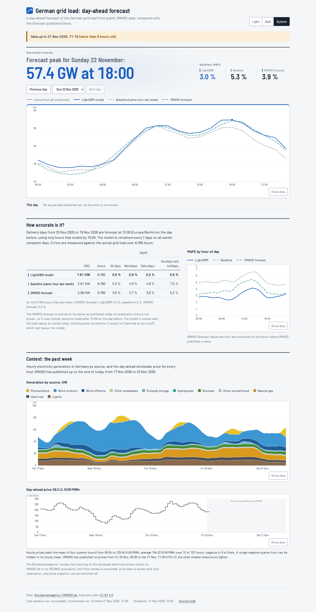
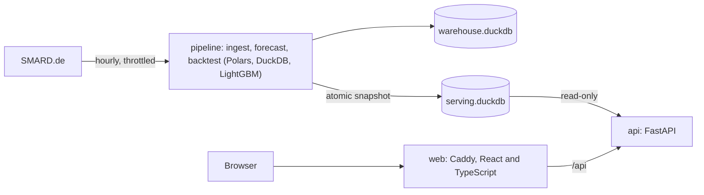

# grid-load-forecast

Day-ahead forecast of the German grid load from public SMARD data, with a validated data pipeline, a reproducible backtest, a read-only API and a dashboard.



## What it does

Every day the pipeline forecasts the grid load for each hour of the next delivery day as of 12:00 (Europe/Berlin), the time the day-ahead electricity market closes. The forecast uses only the information available at 12:00. It is computed by the first hourly run after 12:00 that finds the load up to 10:00 loaded, at 12:05 at the earliest; until then the newest forecast on the dashboard is the one for the current day. If those values are still missing at 20:00, the forecast is issued anyway and marked as computed with incomplete data, unless no load value of the 24 hours before 10:00 is available at all. A LightGBM model is trained on all history since 2015 and may only use hours that ended by 10:00, which matches the publication delay of the source. The dashboard compares the forecast with the actual load, with a naive baseline (the same hour one week earlier) and with the grid load forecast that SMARD publishes.

## How good the forecast is

From the backtest over the delivery days 2025-11-20 to 2026-11-19 (8760 hours, each day forecast as of 12:00 the day before, model retrained weekly), produced by `scripts/backtest.py`:

| Forecast | MAE (MWh per hour) | MAPE |
|---|---:|---:|
| LightGBM model | 1,611 | 3.04 % |
| Baseline (same hour last week) | 2,814 | 5.30 % |
| SMARD grid load forecast | 2,075 | 3.92 % |

All values are scored as they are stored today: later corrections to load values are included, and the SMARD forecast is scored with the values SMARD publishes now, without its publication time, so the comparison may favour it. The full report with results per hour and per day type is in [reports/backtest.md](reports/backtest.md), the method in [Forecast and backtest method](docs/explanation/forecast.md). All 86 metrics in `reports/backtest.json` match a recomputation with scikit-learn in a separate environment (`scripts/crosscheck_metrics.py`).

## Architecture



Three containers: the pipeline and the API share one data volume, and the web server delivers the dashboard. The pipeline is the only writer: it loads weekly chunks from SMARD, validates each one strictly (length, 15-minute steps, value types, non-negative energies), keeps permanent gaps in the source as gaps, stores quarter-hour values in UTC with corrections as revisions, issues the forecast and publishes a read-only snapshot by atomic rename. The API reads only that snapshot, so reading and writing never compete for the DuckDB file. Details are in [Architecture](docs/explanation/architecture.md) and [Data source](docs/explanation/data-source.md).

## Quickstart

Requirements: Docker with Compose v2, port 8460 free, memory for container limits totalling 2.6 GB, and disk space on the data volume (our full backfill on 21 November 2026 took 0.58 GB, and DuckDB may use up to 4 GB of temporary space during large operations).

```bash
git clone https://github.com/deka641/grid-load-forecast.git
cd grid-load-forecast
docker compose up -d --build
```

On the first start the pipeline loads the full history (our run on 21 November 2026: 75 minutes for 8,973 weekly chunks; the time depends on SMARD and the network), then issues the forecast if it is already past 12:00 in Germany (otherwise with the first hourly run after noon) and computes the backtest. Open [http://127.0.0.1:8460](http://127.0.0.1:8460). The [tutorial](docs/tutorials/run-locally.md) walks through it.

## Development

```bash
make install       # locked Python (uv) and frontend (npm) environments
make verify-fast   # lint, strict typing, style and secret scans, tests
make verify        # adds dependency vulnerability check, history scan, coverage, API types, builds
```

Both gates run their checks in order and stop at the first failure; tests never reach the network. See [Develop and verify changes](docs/how-to/develop.md) for the release checks (`make smoke`, `make prod-check`, `make loadtest`).

| Path | Content |
|---|---|
| `src/gridload/sources/` | SMARD client and chunk validation |
| `src/gridload/pipeline/` | Migrations, ingestion, snapshot, scheduled jobs |
| `src/gridload/forecast/` | Calendar, features, LightGBM model, backtest, reports |
| `src/gridload/api/` | FastAPI application on the snapshot |
| `web/` | React and TypeScript dashboard (Vite, TanStack Query, Apache ECharts) |
| `docs/` | Documentation (tutorial, how-to guides, reference, explanation) |
| `reports/` | Generated backtest report |

## Data and licence

Data: Bundesnetzagentur | SMARD.de, licensed under [CC BY 4.0](https://creativecommons.org/licenses/by/4.0/). The licensing of wholesale prices is under review by the Bundesnetzagentur (HEDWIG procedure); prices are shown with that reservation and can be switched off. See [DATA-LICENSE.md](DATA-LICENSE.md).

Code: [MIT](LICENSE).
