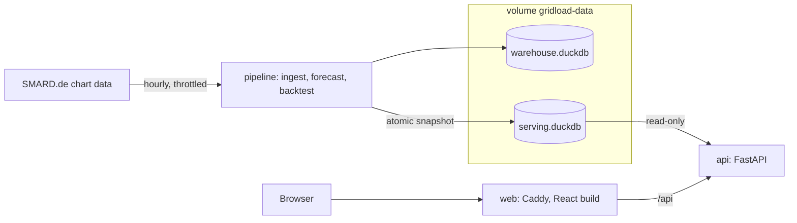

# Architecture

The stack has three services. The pipeline and the API share one Docker volume; the web server has no access to the data. Data flows in one direction: the pipeline writes, the API reads, and the web server delivers the dashboard and forwards API requests.

## Why two database files

DuckDB allows either one process that writes to a file or several processes that read it, but not both at the same time across processes. The pipeline therefore owns `warehouse.duckdb`. After every run it copies the tables the API needs into a temporary file and renames it to `serving.duckdb`. A rename is atomic on Linux, so the API sees either the old or the new snapshot, never a partially written one. The API opens each snapshot read-only in its own in-memory DuckDB instance and switches to a new file when its inode or modification time changes. Requests that are still running finish on the previous snapshot.

The snapshot leaves out the raw source payloads and keeps the last 30 load runs of the log, which makes it smaller than the warehouse. When wholesale prices are switched off, the snapshot contains no price data at all, including prices loaded earlier.

## The hourly job

The pipeline container runs `gridload run` once at start-up and then every hour at minute 5 (UTC), scheduled by supercronic, which never starts a run while the previous one is still active. A run:

1. loads every weekly chunk that is missing, still incomplete, or among the four newest (to pick up corrections);
2. issues the day-ahead forecast once per delivery day, after 12:00 Europe/Berlin and once the hour up to 10:00 is loaded (if that hour is still missing at 20:00, the forecast is issued with the newest data, provided it is at most 24 hours old); a forecast is marked as degraded in its run details when that hour is missing or key features are incomplete (a lag of seven days for any hour, the 24 or 168 hour means, or less than 90 % of the last 168 hours);
3. refreshes the backtest when the last one is older than seven days;
4. publishes the snapshot and writes a heartbeat file.

Each follow-up step is isolated: if the forecast or the backtest fails, the error is logged, the run is marked `partial`, and the fresh data is still published.

On an empty volume the first run is the full backfill of all series since 29 December 2014. See [Run the stack locally](../tutorials/run-locally.md) for the measured duration.

## Health and limits

Every service has a healthcheck. The pipeline counts as healthy while a run reports progress, or when the last run with status `ok` or `partial` is less than 26 hours old and the newest load value is less than 12 hours old. The second condition notices a source that stops publishing although every run succeeds.

Memory limits are set in `compose.yaml` (pipeline 2 GB, api 512 MB, web 128 MB). DuckDB is configured below them: the pipeline uses 4 worker threads and 1 GB of memory and spills to a temporary directory on the volume; each API snapshot instance uses 2 threads and 128 MB. Without these settings DuckDB starts about five threads per host core and assumes 80 % of host memory, which would exceed the container limits on larger machines. The API also limits concurrent heavy requests and answers with a JSON 503 when it is saturated.

## Web server

Caddy serves the static React build and forwards `/api/` to the API. It sets a strict Content Security Policy (only resources from the same origin, no inline scripts or styles), removes the `Server` header, and marks hashed assets as cacheable for a year while `index.html` is revalidated on every load. The web service is bound to `127.0.0.1` only.
