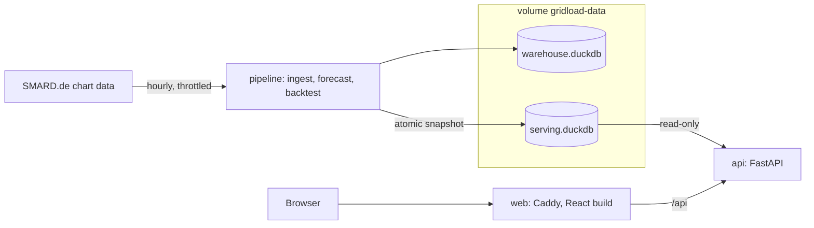

# Architecture

The stack has three services. The pipeline and the API share one Docker volume; the web server has no access to the data. Data flows in one direction: the pipeline writes, the API reads, and the web server delivers the dashboard and forwards API requests.

## Why two database files

DuckDB allows either one process that writes to a file or several processes that read it, but not both at the same time across processes. The pipeline therefore owns `warehouse.duckdb`. After every run it copies the tables the API needs into a temporary file and renames it to `serving.duckdb`. A rename is atomic on Linux, so the API sees either the old or the new snapshot, never a partially written one. The API opens each snapshot read-only in its own in-memory DuckDB instance and switches to a new file when its inode or modification time changes. Requests that are still running finish on the previous snapshot.

The snapshot leaves out the raw source payloads and keeps the last 30 load runs of the log, which makes it smaller than the warehouse. When wholesale prices are switched off, the snapshot contains no price data at all, including prices loaded earlier.

## The hourly job

The pipeline container runs `gridload run` once at start-up and then every hour at minute 5 (UTC), scheduled by supercronic, which never starts a run while the previous one is still active. A run:

1. loads every weekly chunk that is missing, still incomplete, or among the four newest (to pick up corrections);
2. issues the day-ahead forecast once per delivery day, after 12:00 Europe/Berlin and once the hour up to 10:00 is loaded (if that hour is still missing at 20:00, the forecast is issued with the newest data, provided it is at most 24 hours old); a forecast is marked as degraded in its run details when that hour is missing or key features are incomplete (a lag of 1, 2, 7 or 14 days for any hour where it is already published at the cutoff, the 24 or 168 hour means, or less than 90 % of the last 168 hours);
3. refreshes the backtest when the last one is older than seven days;
4. publishes the snapshot and writes a heartbeat file.

Each follow-up step is isolated: if the forecast or the backtest fails, the error is logged, the run is marked `partial`, and the fresh data is still published.

On an empty volume the first run is the full backfill of all series since 29 December 2014. See [Run the stack locally](../tutorials/run-locally.md) for the measured duration.

## Health and limits

Every service has a healthcheck. The pipeline counts as healthy while a run reports progress, or when the last run with status `ok` or `partial` is less than 26 hours old and the newest load value is less than 12 hours old. The second condition notices a source that stops publishing although every run succeeds.

Memory and CPU limits are set in `compose.yaml` (pipeline 2 GiB and 4 cores, api 512 MiB and 3 cores, web 256 MiB and 2 cores). The CPU limits keep one busy or flooded service from taking every core of the host; each is above the peak measured for its service: 3.1 cores for the 365-day backtest (`gridload backtest` on a copy of the warehouse, 21 November 2026), 2.4 cores for the API and 1.7 for the web container under `make loadtest` (same date, before the CPU limits). DuckDB is configured below them: the pipeline uses 4 worker threads and 1 GB of memory and spills to a temporary directory on the volume; each API snapshot instance uses 2 threads and 128 MB. Without these settings DuckDB starts about five threads per host core and assumes 80 % of host memory, which would exceed the container limits on larger machines. Polars and the numerical libraries are limited to 2 threads each. The 365-day backtest peaked at 865 MiB of container memory as sampled with `docker stats`, in a container with the pipeline's limits (same command and date). Every pipeline run is stopped after 3 hours (`timeout` in the start command and in `docker/crontab`), well above the 75 minutes of the first backfill, so a source that answers too slowly cannot hold the pipeline forever while supercronic waits for the run to end. A stopped run keeps the chunks it has loaded; the next run marks it `aborted` and loads the rest. Swap is not allowed beyond the memory limits, and container logs rotate at 10 MB with three files kept.

The API protects itself and the health check against floods: it caps the data requests in progress, in total and per client address, lets one client address hold at most two of the eight query slots (its further requests wait before they take any shared slot), queues the largest requests separately, sends large responses in parts and counts them against a byte budget until they are delivered, and disconnects clients that do not read. `/health` and `/status` stay outside these limits, but not outside uvicorn's limit of 256 open connections, which refuses every route; Caddy therefore opens at most 224 connections to the API, 16 of them each reserved for `/health` and `/status`. `scripts/loadtest_abuse.py` runs abusive clients from containers on the check stack's network. `make prod-check` uses it to assert that `/health` and `/status` answer 200 for one client while another holds 400 connections, and that the web container survives 9,000 half-open connections. On 21 November 2026, with those half-open connections opened by `scripts/loadtest_abuse.py` while `make loadtest` ran, the API container peaked at 195 MiB of its 512 MiB and the web container at 165 MiB of its 256 MiB.

## Web server

Caddy serves the static React build and forwards `/api/` to the API. It sets a strict Content Security Policy (only resources from the same origin, no inline scripts or styles), removes the `Server` and `Via` headers, runs without root rights and without Linux capabilities, closes connections that send no complete request header within 10 seconds or stay idle for 60 seconds, and marks hashed assets as cacheable for a year while `index.html` is revalidated on every load. The web service is bound to `127.0.0.1` only.

## Network

Compose defines two networks. The `default` network carries the published port of the web container and gives the pipeline the internet access it needs for SMARD. The `backend` network is internal (`internal: true`, subnet `10.46.60.0/29`): only the web container (fixed address `10.46.60.2`) and the API (`10.46.60.3`) are attached, and it has no route out. The API is on no other network, so it can neither reach the internet nor be reached by the pipeline or any other container; the pipeline and the API share only the data volume. Only the web container publishes a port.

The API limits data requests per client address, so it needs the address of the browser, not that of Caddy. Caddy sets `X-Forwarded-For` to the address of the connection it received and discards a value that the client sent, since no `trusted_proxies` are configured. uvicorn runs with `--proxy-headers` and `FORWARDED_ALLOW_IPS=10.46.60.2`: it takes the client address from `X-Forwarded-For` only on connections from the web container, and then the right-most address in the header that is not trusted. Any other peer is counted under its own address, whatever header it sends. Both addresses are fixed so that the trusted address cannot be assigned to another container, for example when the API starts before the web container. `make prod-check` checks that a request through Caddy with a forged `X-Forwarded-For` reaches the API with the address Caddy saw. The check stack uses its own subnet (`10.46.60.8/29`, set in `compose.check.yaml`), so it runs next to the live stack.

All requests from the host machine arrive at Caddy from the gateway address of the `default` network, so locally every browser counts as the same client. Behind another reverse proxy, Caddy would see only that proxy's address; such a proxy must set `X-Forwarded-For` and be added to Caddy's `trusted_proxies` and to `FORWARDED_ALLOW_IPS` (see [SECURITY.md](https://github.com/deka641/grid-load-forecast/blob/master/SECURITY.md)).
